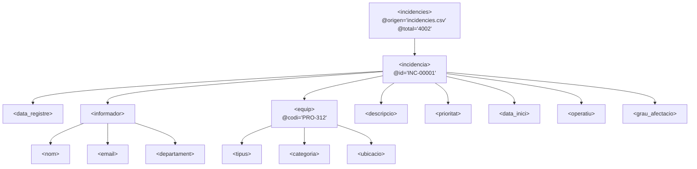

# TA04 · Gestió d'incidències TIC (CSV → XML → JSON)

**Mòdul 0373 – Llenguatges de Marques · ITB · Curs 26/27**  
**Grup:** `G6`  
**Membres:** `Aguilar Claure, Kevin`, `Laarej, Samire`, `Colomer de Haro, Albert`  

---

## 📁 Estructura del projecte

```text
projecte/
├── README.md                 ← Documentació completa de la tasca i rúbrica
├── presentacio.html          ← Diapositives interactives per a la presentació oral (4 minuts)
├── dades/
│   ├── incidencies.csv       ← Exportació del formulari (4.002 registres)
│   ├── incidencies.xml       ← Migració estructurada CSV a XML
│   └── incidencies.json      ← Emmagatzematge net en JSON (filtratge aplicat)
├── src/
│   ├── csv_a_xml.py          ← Script Python per a la conversió CSV → XML
│   └── processa.py           ← Script Python de processament, filtratge, informe per consola i JSON
└── tasca1_formulari/
    ├── ENLLACOS.txt          ← Enllaços del formulari públic, edició i Google Sheets
    ├── CrearFormulari.gs     ← Codi Google Apps Script que va crear el formulari
    └── GenerarRespostes.gs   ← Codi per poblar les 4.000 incidències de prova
```

---

## 1. Obtenció de dades (Formulari Google Forms)

Hem dissenyat un formulari per recollir incidències sobre equipaments informàtics i audiovisuals amb **13 camps recollits** (superant el mínim de 10 requerits):

1. **ID**: Identificador únic (`INC-00001`...).
2. **Timestamp (Marca temporal)**: Data i hora automàtica del registre.
3. **Nom i cognoms**: Persona que informa.
4. **Correu electrònic**: Email institucional (`@itb.cat`).
5. **Departament**: Llistat desplegable (Docència, Administració, Sistemes, etc.).
6. **Ubicació de l'equip**: Aula o espai on es troba (Aula 101, Lab Xarxes, CPD, etc.).
7. **Tipus d'equip**: Ordinador, Portàtil, Projector, Impressora, Pissarra digital, etc.
8. **Codi d'inventari**: Codi físic de l'etiqueta (`ABC-123`).
9. **Categoria**: Hardware, Software, Xarxa, Perifèrics, Audiovisual, Comunicacions.
10. **Descripció del problema**: Detall de l'avaria o incidència.
11. **Prioritat**: Baixa, Mitjana, Alta, Crítica.
12. **Data d'inici**: Quan va començar el problema.
13. **Estat operatiu**: Si l'equip es pot seguir fent servir o no.
14. **Grau d'afectació**: Escala de l'1 al 5.

Totes les dades s'han recollit a Google Sheets i exportat a `dades/incidencies.csv` amb un total de **4.002 registres**.

---

## 2. Migració CSV a format XML

L'script `src/csv_a_xml.py` converteix les línies del CSV en un document XML jeràrquic i semàntic.

### Diagrama de l'arbre XML resultant:



> **Privacitat i RGPD:** La conversió s'ha realitzat mitjançant codi i processament local de dades sense enviar informació de caràcter personal a cap servei extern d'IA de tercers.

---

## 3. Processament de dades i sortida per pantalla

L'script `src/processa.py` analitza el fitxer `incidencies.xml`:

### Diferència entre dades i informació:
* **Dada**: Conjunt de caràcters o valors aïllats en brut (`"Aula 305"`, `"Crítica"`, `"Projector"`). No aporten context ni capacitat de decisió directa per si sols.
* **Informació**: El resultat de processar, netejar i agregar les dades (`"El 28% de les incidències crítiques es concentren a l'Aula 305 i corresponen a projectors amb làmpada defectuosa"`). Permet la presa de decisions (enviar tècnic urgent, reposar bombetes).

### Filtratge de dades errònies:
El programa detecta i filtra automàticament registres no vàlids abans d'extreure estadístiques:
- Incidències amb **data futura fictícia** (per exemple de l'any `2064`).
- Incidències amb la **descripció buida**.
- Emails sense format vàlid o duplicats.

### Estadístiques mostrades per consola:
- Gràfics de barres visuals amb colors ANSI.
- Distribució per nivell de prioritat (Crítica, Alta, Mitjana, Baixa).
- Distribució per tipus d'equip i categoria.
- Top 5 ubicacions amb més incidències.
- Top 5 avaries més freqüents.

---

## 4. Emmagatzematge en JSON

El mateix script desa la informació processada i filtrada a `dades/incidencies.json`:
- Comprova si el fitxer ja existeix.
- Si existeix, ofereix interactívament:
  1. **Sobreescriure** amb les dades noves.
  2. **Afegir noves incidències** preservant les existents i verificant duplicats per clau `id`.
  3. Cancel·lar.

---

## 5. Instruccions d'execució

Amb Python 3 instal·lat al sistema:

```bash
# Pas 1: Generar l'XML a partir del CSV
python src/csv_a_xml.py

# Pas 2: Processar, veure l'informe i desar en JSON
python src/processa.py
```

Per a la presentació oral de 4 minuts, només cal fer doble clic sobre `presentacio.html` per obrir les diapositives al navegador.